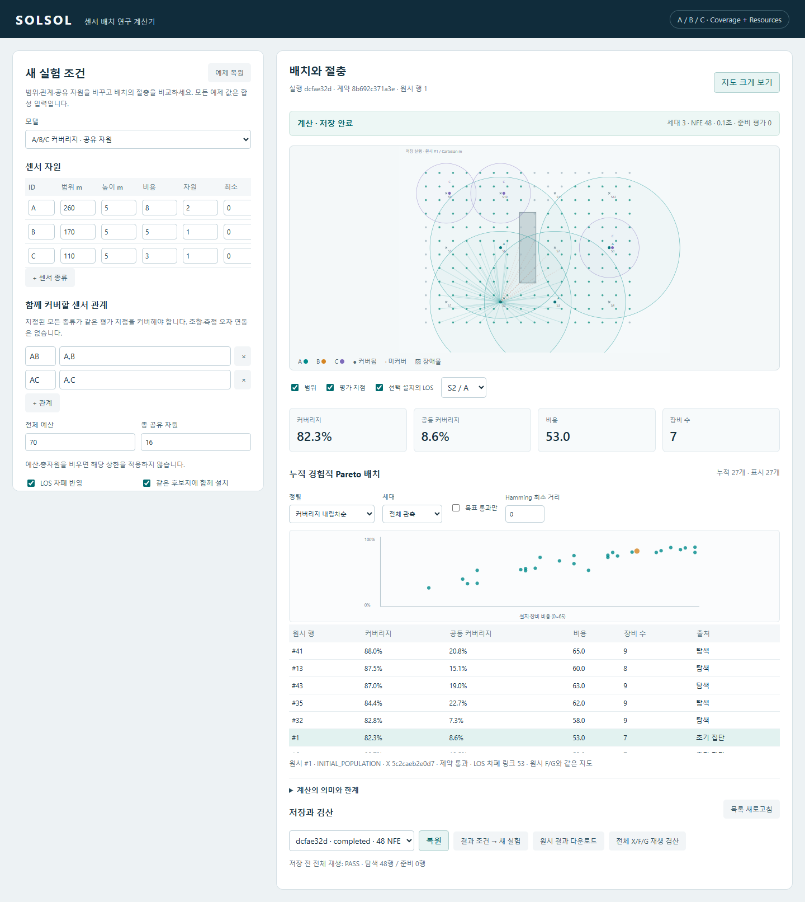

# SOLSOL — 범용 센서 배치 연구 계산기

센서 A/B/C의 **수평 커버 범위, 비용, 재고, 센서 간 공동 커버 관계와 공유 설치 자원**을 조절하고, MOEA로 배치의 절충을 탐색하는 독립 실행 프로젝트입니다. 센서 종류와 개수는 설정으로 바꿀 수 있습니다.

원래 프로젝트의 계산기 구조에서 재사용 가능한 부분을 추출했습니다. 기존 장비별 물리·융합 모델, 오차·각도·조향 수식과 과거 실험 결과는 포함하지 않습니다. 원본 프로젝트는 별도 위치에 보존되며 이 저장소 실행에 필요하지 않습니다.



## 시작하기

Python 3.11 이상을 사용합니다. Windows PowerShell:

```powershell
git clone https://github.com/SUNYUILEE/solsol.git
cd solsol
py -3 -m venv .venv
.venv\Scripts\python -m pip install -e ".[test]"
.venv\Scripts\python -m solsol serve
```

[로컬 연구 화면](http://127.0.0.1:8877)을 엽니다. 설치 후에는 `START.cmd`로 실행할 수 있습니다. Linux/macOS는 `python3 -m venv .venv` 후 `.venv/bin/python`을 사용합니다. 핵심 계산에는 브라우저나 인터넷이 필요하지 않습니다.

1. 센서 범위·높이·비용·자원·수량과 센서 관계를 폼에서 조절합니다.
2. 평가 격자, 설치 후보지, 설치 용량과 LOS 장애물을 입력합니다. 평가 영역 밖 후보지도 설치할 수 있습니다.
3. 목적·선택적 목표, 알고리즘·초기화·seed·평가 예산을 선택해 조건을 확인합니다.
4. 계산 결과에서 Pareto 행을 선택하고 같은 원시 행의 지도·비용·커버리지를 확인합니다.
5. 세대·정렬·목표·Hamming 필터, 지도 크게 보기와 LOS 레이어를 사용합니다.
6. 결과는 전체 원시 행의 재생 검산 후 `data/runs/`에 자동 저장합니다. 서버를 다시 시작한 뒤 복원·재생·JSON 다운로드가 가능합니다. 새 실험 조건과 선택한 저장 결과 조건은 구분합니다.

## 명령줄

```powershell
python -m solsol example --output scenario.json
python -m solsol run --config scenario.json --algorithm NSGA-II --initializer greedy --seed 11 --population 48 --generations 30
python -m solsol list
python -m solsol replay <run-id>
python -m solsol audit <run-id> --row 0 --budget 512 --output local-check.json
```

`audit --exact`는 활성 이진 변수 16개 이하의 작은 문제만 전수 열거합니다. Python API에서는 명시적으로 최대 20개까지 허용할 수 있습니다. 진단·reference 해는 optimizer 원시 해에 합치지 않습니다. 여러 seed를 비교할 때는 같은 입력·초기화·개체 수·세대·준비 예산을 사용하고 준비/탐색 평가 수를 각각 비교하세요.

## 새 예제 모델의 의미

| 항목 | 정의 |
| --- | --- |
| 배치 | 후보지 × 센서 종류의 이진 행렬 |
| 범위 | XY 평면 수평 반경, 단위 m. 높이는 LOS에 사용 |
| 커버리지 | 한 종류 이상이 커버하는 평가 지점의 가중 비율. 중복 지점을 한 번 계산 |
| 공동 커버리지 | 각 관계에 지정된 모든 종류가 같은 지점을 커버하는 비율의 관계별 평균 |
| 비용 | 장비별 비용 합 + 사용 후보지별 설치비 한 번 |
| 공유 자원 | 후보지 용량 및 전체 자원 상한과 비교하는 장비별 자원량 |
| 목적 | 커버리지 최대·공동 커버리지 최대·비용 최소 중 2개 이상 |
| 제약 | 종류별 최소/최대 재고, 후보지 용량, 선택적 예산·총자원·커버리지 목표 |
| LOS | 설치 XYZ→평가 XYZ 선분과 명시적인 3D 직육면체의 교차. 접촉도 차폐 |

공동 커버리지는 사용자가 정의한 공간적 관계입니다. 실제 장비의 통신·탐지·오차 개선·조향을 가정하지 않습니다. 지형은 높이 블록으로 입력할 수 있지만 연속 DEM·지구 곡률·회절·실제 건물 높이 수집은 구현하지 않았습니다. 커버리지는 이산 표본의 값이며 연속 면적의 정확한 적분이 아닙니다.

## 보존한 계산기 구조와 새 모델의 경계

```text
solsol/engine/       배치 표현, 재고 초기화·수선, NSGA-II/III, 누적 archive,
                     체크포인트, 저장, 검산, Hamming/대표해, 사후 진단
solsol/models/      새 커버리지·공유 자원 예제 모델 (교체 가능)
solsol/geometry.py  명시적인 3D prism LOS
solsol/server.py    비동기 실행·중지·저장·복원 API
solsol/web/         조건 폼·지도·절충 그래프·세대 재생·근거
tests/              해석 가능한 반례, 독립 작은 전수 기준, 통합 검사
docs/               계약, 재사용 안내, 이전 계보와 검증 근거
```

[모델 교체 방법](docs/MODEL_API.md), [수학적 계약](docs/MODEL_CONTRACT.md), [추출 계보](MIGRATION_MANIFEST.json), [검증 인덱스](docs/VERIFICATION.md)를 참고하세요. 초기화·탐색은 계산기 소유이며 모델의 전용 builder를 요구하지 않습니다. Greedy/MILP는 공개 평가 결과를 사용하고 제안을 원 모델로 다시 평가합니다.

## 재현성과 한계

각 실행에 입력 스냅샷·계약 ID·후보/센서/목적/제약 순서·코드 지문·라이브러리 버전·seed·초기화 출처·원시 X/F/G·실제 평가 수·모든 세대·누적 경험적 archive를 보관합니다. 저장 시 checksum과 전체 행 검산을 수행하며, 다른 코드 지문으로 과거 실행을 조용히 재평가하지 않습니다. 이후 코드가 바뀌면 해당 실행을 생성한 Git commit 환경으로 돌아가 별도 clone에서 재생하세요.

MILP는 국소 선형 근사 제안이며 비선형 문제의 전역 최적성을 보증하지 않습니다. Pareto·Hamming·검산 PASS도 현장 성능, 전역 최적성, 사람의 이해도를 인증하지 않습니다. 이 저장소는 새 연구의 재사용 기반이며 원본 전체 제품의 모든 기능을 그대로 복제한 것은 아닙니다. 합성 예제 값은 실제 장비 기본값이나 검증된 성능이 아닙니다.

## 검사

```powershell
python -m pytest -q -p no:cacheprovider
python tools/browser_check.py
```

브라우저 검사는 설치된 Microsoft Edge와 Playwright를 사용합니다. 실제 계산·저장·별도 서버 프로세스 복원 흐름과 1920/1440/1280 화면을 검사합니다. 자동검사를 실제 사람 사용성 검증으로 해석하지 않습니다.
